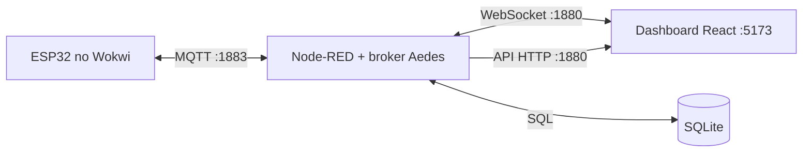

# 🚦 Semáforo Inteligente | Projeto IoT

**Trabalho final da disciplina de Programação Multiplataforma da Faculdade de Tecnologia de Sorocaba (FATEC Sorocaba).**

> Simulação de mobilidade urbana que integra um ESP32 no Wokwi, comunicação MQTT, processamento no Node-RED, persistência SQLite e um dashboard interativo em React.

## 📑 Sumário

- [Sobre o projeto](#-sobre-o-projeto)
- [Objetivos](#-objetivos)
- [Funcionalidades](#-funcionalidades)
- [Arquitetura](#-arquitetura)
- [Componentes e conexões](#-componentes-e-conexões)
- [Funcionamento do semáforo](#-funcionamento-do-semáforo)
- [Comunicação MQTT](#-comunicação-mqtt)
- [Node-RED e API](#-node-red-e-api)
- [Banco de dados](#-banco-de-dados)
- [Dashboard](#-dashboard)
- [Como executar](#-como-executar)
- [Testes de integração](#-testes-de-integração)
- [Tecnologias](#-tecnologias)
- [Possíveis evoluções](#-possíveis-evoluções)

## 📌 Sobre o projeto

O **Semáforo Inteligente** é um projeto de **Internet das Coisas (IoT)** aplicado à **mobilidade urbana**. Seu propósito é demonstrar como sensores, dispositivos conectados, processamento de eventos e interfaces visuais podem apoiar o acompanhamento do trânsito e a segurança de pedestres.

A proposta inicial considerava ajustar os tempos dos semáforos automaticamente conforme o fluxo de veículos. **Na implementação atual, o ciclo dos veículos utiliza tempos predefinidos**, mas pode ser antecipado e estendido em resposta ao pedido de travessia de pedestres. O fluxo de veículos é simulado visualmente e as passagens são registradas e classificadas conforme a cor oficial publicada pelo ESP32.

O projeto permite observar o comportamento dos sinais, visualizar a circulação de carros, solicitar travessia, identificar passagens no vermelho e acompanhar estatísticas em tempo real.

## 🎯 Objetivos

- 🚗 Simular e monitorar passagens de veículos.
- 🚦 Representar os estados do semáforo controlados pelo ESP32.
- 🚶 Atender solicitações de travessia com ajuste do ciclo semafórico.
- 📡 Integrar hardware simulado e software por MQTT e WebSocket.
- 📊 Exibir estados, contagens, indicadores e alertas em um dashboard.
- ⚠️ Detectar e registrar passagens durante o sinal vermelho.
- 💾 Manter um histórico consultável de passagens em SQLite.

**Área de aplicação:** mobilidade urbana, monitoramento de trânsito e demonstração educacional de sistemas IoT.

## ✨ Funcionalidades

| Funcionalidade | Comportamento atual |
| --- | --- |
| Semáforo veicular | Ciclo automático verde → amarelo → vermelho |
| Travessia de pedestres | Botão físico no Wokwi ou virtual no dashboard |
| Detecção por ultrassom | HC-SR04 registra evento quando a distância fica abaixo de 50 cm |
| Tráfego virtual | Carros animados em uma rua de pixel art |
| Registro de passagens | Node-RED valida e grava placa, horário e sinal no SQLite |
| Identificação de infrações | Passagens no vermelho geram aviso e sinalização sonora |
| Telemetria | Estado, tempo restante e status do ESP32 enviados ao dashboard |
| Alertas de comunicação | Avisos de dados atrasados, ESP32 offline e desconexão do Node-RED |
| API HTTP | Consultas de passagens, infrações e estatísticas |

## 🏗️ Arquitetura

O **ESP32 é a fonte oficial do estado do semáforo**. O dashboard exibe esse estado e simula os veículos. O Node-RED integra os dois lados, valida os eventos e acessa o banco.



**Fluxo do semáforo:** ESP32 → MQTT → Node-RED → WebSocket → dashboard.

**Fluxo de passagem:** carro simulado no dashboard → WebSocket → validação no Node-RED → SQLite → confirmação ao dashboard e comando MQTT ao ESP32.

> **Importante:** os carros animados existem no frontend, não no Wokwi. O sensor HC-SR04 do Wokwi pode gerar eventos próprios, identificados pela placa fictícia `WOKWI`. O dashboard não representa uma leitura física direta de cada carro animado pelo HC-SR04.

## 🔌 Componentes e conexões

A simulação utiliza uma placa **ESP32 DevKit C v4**, com firmware em C++ desenvolvido com PlatformIO.

| Componente | Função | GPIO |
| --- | --- | --- |
| LED vermelho, amarelo e verde | Sinalização veicular | 25, 26, 27 |
| LED vermelho e verde | Sinalização para pedestres | 32, 33 |
| Botão | Solicitação de travessia | 14 (`INPUT_PULLUP`) |
| Sensor ultrassônico HC-SR04 | Detecção de objetos/veículos simulados | TRIG 5, ECHO 18 |
| Buzzer | Confirmações e alertas sonoros | 13 |

**Arquivos principais:** `wokwi/diagram.json`, `wokwi/platformio.ini`, `wokwi/wokwi.toml`, `wokwi/src/main.cpp` e `wokwi/include/config.h`.

O servomotor mencionado na concepção inicial **não faz parte dos componentes descritos na implementação atual**.

## 🚦 Funcionamento do semáforo

| Estado | Duração padrão |
| --- | ---: |
| Verde | 12 segundos |
| Amarelo | 3 segundos |
| Vermelho | 8 segundos |
| Vermelho após pedido de pedestre | 10 segundos |

Quando o botão de pedestre é acionado durante o verde, o verde é encerrado em **até 3 segundos**, e o próximo vermelho dura **10 segundos**. Se o sinal já está vermelho, o pedido é ignorado. O sinal de pedestres fica verde apenas enquanto o sinal veicular está vermelho.

Após o registro de uma passagem, o ESP32 pode emitir **um bip** para passagem no verde ou amarelo e **três bips** para passagem no vermelho. O Monitor Serial também apresenta informações da passagem.

## 📡 Comunicação MQTT

O broker MQTT utiliza o **Aedes**, integrado ao Node-RED, na porta `1883`. O prefixo dos tópicos é `fatec/semaforo/01`.

| Tópico completo | Direção | Finalidade |
| --- | --- | --- |
| `fatec/semaforo/01/estado` | ESP32 → Node-RED | Estado do semáforo, tempos e solicitação de pedestre; a cada 1 s |
| `fatec/semaforo/01/status` | ESP32 → Node-RED | Conectividade, Wi-Fi e uptime; a cada 10 s |
| `fatec/semaforo/01/sensor/botao` | ESP32 → Node-RED | Acionamento do botão físico |
| `fatec/semaforo/01/sensor/veiculo` | ESP32 → Node-RED | Detecção pelo HC-SR04 |
| `fatec/semaforo/01/cmd/botao_virtual` | Node-RED → ESP32 | Pedido de travessia pelo dashboard |
| `fatec/semaforo/01/cmd/passagem` | Node-RED → ESP32 | Confirmação de passagem registrada |

O firmware utiliza o broker em `host.wokwi.internal:1883` para alcançar o serviço na máquina anfitriã. O tópico de status usa mensagem retida e **Last Will** para indicar a desconexão do dispositivo.

## 🔀 Node-RED e API

O backend fica em `node-red/`. Seu fluxo, definido em `flows.json`, reúne:

1. **Broker MQTT:** recebe e publica mensagens.
2. **Inicialização do banco:** executa o esquema SQL e carrega totais.
3. **Telemetria:** acompanha o estado oficial do ESP32 e envia atualizações ao dashboard.
4. **Passagens:** valida eventos recebidos por WebSocket, grava no banco e emite confirmações.
5. **API HTTP:** disponibiliza consultas de histórico e estatísticas.

### Regras de validação

Uma passagem é rejeitada quando:

- a placa não é `1`, `2`, `3` ou `WOKWI`;
- o ESP32 ainda não publicou estado ou está offline;
- a mesma placa já foi registrada nos últimos **3 segundos**.

A cor armazenada é **sempre a última cor informada pelo ESP32**, independentemente da cor enviada pelo frontend.

### Endpoints

| Método e rota | Resposta |
| --- | --- |
| `GET /api/passagens?limite=10` | Últimas passagens |
| `GET /api/infracoes` | Passagens no vermelho, até 100 |
| `GET /api/estatisticas` | Totais por cor e registros do dia |
| `GET /api/resumo-por-placa` | Estatísticas de cada veículo |

**Editor Node-RED:** `http://localhost:1880`  
**WebSocket:** `ws://localhost:1880/ws/semaforo`

## 💾 Banco de dados

O **SQLite** armazena as passagens na tabela `passagens`:

| Campo | Conteúdo |
| --- | --- |
| `id` | Identificador autoincremental |
| `registrado_em` | Data e hora em UTC, formato ISO 8601 |
| `placa` | `1`, `2`, `3` ou `WOKWI` |
| `sinal` | `VERDE`, `AMARELO` ou `VERMELHO` |

O arquivo `database/schema.sql` define a estrutura, os índices e as views `v_infracoes` e `v_resumo_por_placa`. O arquivo `semaforo.db` é gerado na execução e não precisa ser versionado.

## 🎮 Dashboard

O frontend em `frontend/` utiliza **React 19, TypeScript e Vite**. A interface em pixel art apresenta uma rua, os semáforos, carros animados e um pedestre controlado pelas teclas **← / →** ou **A / D**.

O dashboard inclui:

- 🚦 **Semáforo:** cor atual, contagem regressiva, tempos e modo de operação.
- 🚗 **Passagens:** total de veículos, taxa por minuto e distribuição por cor.
- ⚠️ **Infrações:** quantidade, percentual e última ocorrência.
- 🧾 **Histórico:** registros recentes com horário, veículo e sinal.
- 🔔 **Alertas:** condições de comunicação e pedidos de pedestre.
- 🔘 **Botão virtual:** envia solicitação de travessia ao ESP32.

A simulação exibe até **três carros simultâneos**, com surgimento aproximado a cada **5 a 9 segundos**. No vermelho, os veículos normalmente param, mas uma parcela avança para permitir demonstrar infrações. No amarelo, o comportamento considera a proximidade da faixa.

O som no navegador depende de uma interação inicial do usuário com a página.

### Exemplo de telemetria

```json
{
  "type": "telemetry",
  "deviceId": "esp32-semaforo-01",
  "light": { "state": "GREEN", "remainingS": 9, "durationS": 12 },
  "times": { "verde": 12, "amarelo": 3, "vermelho": 8, "vermelhoPedestre": 10 },
  "mode": "AUTOMATICO",
  "pedestrianRequest": false,
  "device": { "online": true, "wifiRssi": -58, "uptimeS": 1234 },
  "alerts": [],
  "passages": { "total": 13, "green": 8, "yellow": 2, "red": 3, "perMin": 6 }
}
```

## 🚀 Como executar

### Pré-requisitos

- **Node.js 22.9 ou superior**, com npm.
- **Visual Studio Code**.
- Extensões **PlatformIO IDE** e **Wokwi Simulator** no VS Code.
- Dependências instaladas nas pastas `node-red` e `frontend`.

### 1. Instale as dependências

No terminal, a partir da raiz `semaforo-inteligente`:

```powershell
cd node-red
npm.cmd install
cd ../frontend
npm.cmd install
cd ..
```

> No PowerShell do Windows, `npm.cmd` evita o erro de bloqueio de execução do `npm.ps1`. Em terminais que não apresentam esse problema, use `npm` normalmente.

### 2. Abra o workspace

No VS Code, selecione **File → Open Workspace from File...** e abra `semaforo.code-workspace`.

### 3. Inicie o Node-RED e o frontend

No VS Code, acesse **Terminal → Run Task... → Subir Node-RED + Frontend**.

Essa tarefa inicia o backend e o servidor de desenvolvimento do dashboard. Mantenha os terminais abertos.

Caso a tarefa não funcione, execute em **dois terminais separados**, partindo da raiz do projeto:

**Terminal A:**

```powershell
cd node-red
npm.cmd start
```

**Terminal B:**

```powershell
cd frontend
npm.cmd run dev
```

Confira se o editor Node-RED abre em `http://localhost:1880` e o dashboard em `http://localhost:5173`.

### 4. Compile o firmware do ESP32

Use **Terminal → Run Task... → Firmware: compilar (PlatformIO)** ou abra a pasta `wokwi` como projeto PlatformIO e execute **Project Tasks → esp32dev → General → Build**.

A compilação deve gerar:

```text
wokwi/.pio/build/esp32dev/firmware.bin
wokwi/.pio/build/esp32dev/firmware.elf
```

O arquivo `wokwi/wokwi.toml` deve apontar para esses caminhos **relativos à pasta `wokwi`**:

```toml
[wokwi]
version = 1
firmware = ".pio/build/esp32dev/firmware.bin"
elf = ".pio/build/esp32dev/firmware.elf"
```

> Se o ambiente do `platformio.ini` não se chamar `esp32dev`, ajuste os caminhos conforme o nome real do ambiente. Compile novamente sempre que alterar o firmware.

### 5. Inicie o Wokwi

Abra `wokwi/diagram.json`, pressione **Ctrl + Shift + P** e execute **Wokwi: Start Simulator**. O Node-RED deve estar iniciado para receber a telemetria MQTT.

### 6. Acesse o dashboard

Abra `http://localhost:5173` no navegador. Os carros virtuais começam a circular automaticamente. Teste o botão de pedestre, as mudanças de sinal e os registros de passagem.

### Modos alternativos

- **Sem Wokwi:** execute a tarefa **ESP32 de teste** ou, na pasta `node-red`, rode `npm.cmd run esp32-fake`. No simulador, `p` aciona o botão, `c` simula um veículo e `q` encerra. **Não execute o ESP32 fictício junto com o Wokwi**, pois ambos publicam nos mesmos tópicos.
- **Sem backend:** com o frontend iniciado, acesse `http://localhost:5173/?fonte=simulacao`. Esse modo simula os eventos no navegador e não grava passagens no SQLite.

### Solução de problemas

| Problema | Verificação recomendada |
| --- | --- |
| `npm.ps1` bloqueado | Use `npm.cmd` ou ajuste a tarefa do VS Code para chamar `npm.cmd` |
| `firmware.bin` ou `firmware.elf` ausente | Compile o projeto pelo PlatformIO e confira o nome do ambiente |
| MQTT com erro `estado -2` | Verifique Node-RED, broker na porta `1883` e firewall do Windows |
| Dashboard sem atualização | Confira o Node-RED, a conexão WebSocket e a execução do Wokwi |
| Frontend não abre | Confira se o Vite iniciou na porta `5173` |

## 🧪 Testes de integração

Os cenários abaixo descrevem **como validar o comportamento esperado**. Eles não representam, por si só, evidência de que os testes foram executados.

| Teste | Procedimento | Resultado esperado |
| --- | --- | --- |
| Sincronização | Iniciar Wokwi, Node-RED e dashboard | Luzes da interface acompanham o ESP32 |
| Respeito ao sinal | Aguardar o vermelho | Carros param na faixa e retomam no verde |
| Passagem | Aguardar um carro cruzar o sensor virtual | Registro no banco, atualização do painel e bip |
| Infração | Aguardar um carro avançar no vermelho | Aviso `MULTA!`, contagem de infrações e três bips |
| Pedestre | Acionar botão durante o verde | Verde encerra em até 3 s e vermelho dura 10 s |
| HC-SR04 | Simular distância inferior a 50 cm | Registro de passagem com placa `WOKWI` |
| ESP32 offline | Interromper Wokwi | Avisos de dados atrasados e de falta de comunicação |
| Node-RED offline | Interromper Node-RED | Alerta de desconexão e tentativa de reconexão |

## 🛠️ Tecnologias

| Camada | Tecnologias |
| --- | --- |
| Dispositivo IoT | ESP32, C++, Arduino, PubSubClient, ArduinoJson |
| Desenvolvimento do firmware | PlatformIO |
| Simulação de hardware | Wokwi |
| Mensageria | MQTT, Aedes |
| Integração e processamento | Node-RED 5, WebSocket, API HTTP |
| Persistência | SQLite |
| Interface | React 19, TypeScript, Vite, pixel art |

## 🔭 Possíveis evoluções

- Ajuste automático dos tempos dos sinais com base no fluxo de veículos medido.
- Análise de congestionamentos e padrões de tráfego ao longo do tempo.
- Sensores adicionais para distinguir tipos de veículos e medir ocupação das vias.
- Expansão para múltiplos cruzamentos e coordenação entre semáforos.

> **Nota de escopo:** o ajuste automático por volume de tráfego e o uso de servomotor pertencem à proposta inicial ou a possíveis evoluções. Não são apresentados aqui como funcionalidades já implementadas.

---

## 👥 Desenvolvedores
<p align="left">
  <a href="https://github.com/BellaFGS">
    <strong>BellaFGS</strong>
  </a>
  <br/>
  <sub>Desenvolvimento e gestão de projetos</sub>
  <br/><br/>
  <a href="https://github.com/Oroboni">
    <strong>Oroboni</strong>
  </a>
  <br/>
  <sub>Desenvolvimento de QA</sub>
  <br/><br/>
  <a href="https://github.com/Thomas-1610">
    <strong>Thomas-1610</strong>
  </a>
  <br/>
  <sub>Desenvolvimento da estrutura</sub>
<br/><br/>
    <a href="https://github.com/mkrosz">
        <strong>MikeF.</strong>
    </a>
   <br/>
  <sub>Documentação e validação</sub>
</p>

---

**FATEC Sorocaba · Programação Multiplataforma · Projeto acadêmico de Internet das Coisas**
